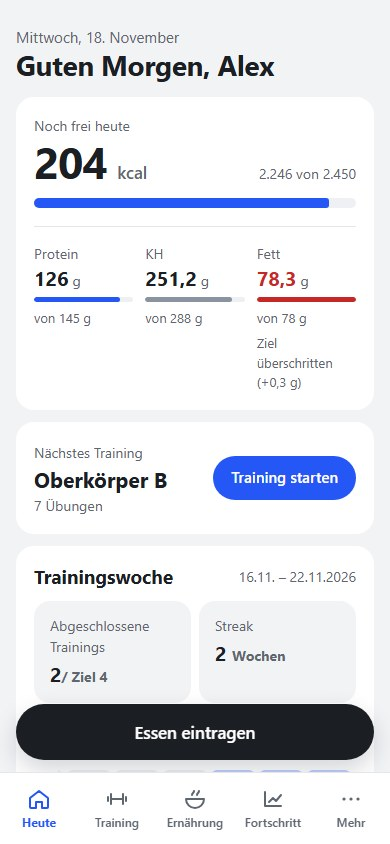
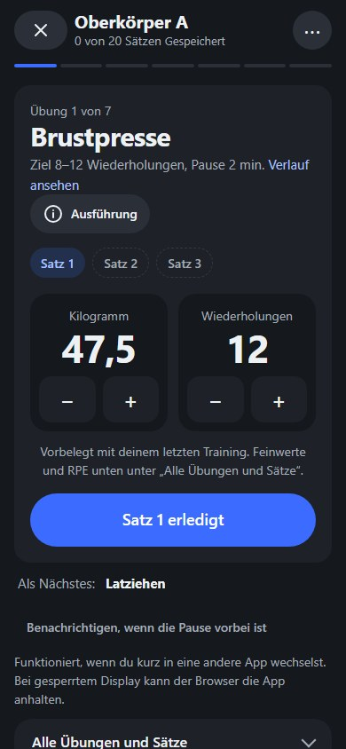
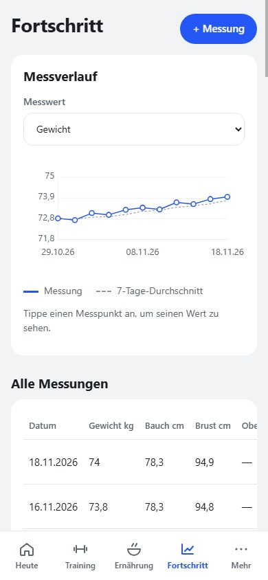

# PROJECT MASS

Installierbare App für Krafttraining, Ernährung und Fortschritt mit lokalem Speicher und Offline-Modus.

<p>
  
  
  
</p>

## Funktionen

- **Training:** Eigene Pläne, Live-Tracking, Pausentimer, Satztypen, Steigerungsvorschläge, Verlauf und Anleitungen für 60 Übungen.
- **Ernährung:** Mahlzeiten, Schnelleinträge, Wasser, Makroziele, Rezepte, eigene Lebensmittel sowie Online-Suche und Barcode-Abfrage.
- **Fortschritt:** Körpermessungen und Diagramme, Rekorde, geschätztes 1RM, Trainingshäufigkeit und Wochenbericht.
- **Daten:** JSON-Backup, optionaler Abgleich mit dem eigenen NAS, Import älterer PROJECT-MASS-Backups, CSV-Export und KI-Import für Trainingspläne und Ernährung.

## Jetzt nutzen

Öffne die App einmal vollständig online. Danach sind die lokale App und die mitgelieferten Übungsbilder auch offline verfügbar. [PROJECT MASS öffnen](https://zwenjam.github.io/project-mass/)

- **Android (Chrome):** Im Browsermenü „App installieren“ oder „Zum Startbildschirm hinzufügen“ wählen.
- **iPhone (Safari):** Im Teilen-Menü „Zum Home-Bildschirm“ wählen und hinzufügen.
- **Desktop:** In unterstützten Browsern das Installationssymbol in der Adressleiste oder den Menüpunkt zur Installation verwenden.

## Datenschutz

Dein Profil, Training, Ernährung und die Einstellungen liegen in IndexedDB in diesem Browser. PROJECT MASS verwendet kein Benutzerkonto und betreibt keinen eigenen Datendienst.

- Wenn du den NAS-Sync aktivierst, liest und schreibt die App Trainings-, Ernährungs- und Profildaten direkt im gewählten NAS-Ordner. WebDAV-Zugangsdaten, Geräteeinstellungen und der USDA-Key bleiben beim Sync auf dem jeweiligen Gerät.
- Open Food Facts erhält den Suchbegriff oder Barcode, wenn du die Online-Suche nutzt. Produktbilder werden vom Bildserver der Quelle geladen.
- Die optionale USDA-Suche sendet Suchbegriff und API-Key an USDA FoodData Central. Der Key liegt lokal im Profil und ist in vollständigen Backups enthalten.
- Videolinks öffnen YouTube oder den von dir hinterlegten Anbieter. Der KI-Import verwendet die Zwischenablage bzw. lokal ausgewählte Dateien. Erst wenn du einen Prompt selbst an einen KI-Dienst weitergibst, erhält der Dienst die darin enthaltenen Angaben.
- Beim Aufruf der App über GitHub Pages protokolliert GitHub IP-Adressen zu Sicherheitszwecken. [Hinweise zu GitHub Pages](https://docs.github.com/en/pages/getting-started-with-github-pages/what-is-github-pages#data-collection)

Lade regelmäßig unter **Mehr → Daten und Backup** eine Sicherung herunter und bewahre sie privat auf. Ein Backup dieser App ersetzt beim Einspielen die aktuellen Daten.

## Bekannte Grenzen

- **Pausen-Benachrichtigung:** Funktioniert, wenn du kurz in eine andere App wechselst. Bei gesperrtem Display kann der Browser die App anhalten. Die Benachrichtigung benötigt eine Freigabe.
- **iPhone und Safari:** Safari kann Web-App-Daten nach längerer Nichtnutzung löschen. Lade deshalb regelmäßig ein Backup herunter.
- **Barcode-Scan:** Die Kamera benötigt HTTPS und eine Kamerafreigabe. Barcodes lassen sich auch manuell eingeben.
- **Gerätewechsel:** Richte auf beiden Geräten dasselbe NAS-Ziel ein oder übertrage die Daten per Backup.

## Sync mit dem eigenen NAS

Öffne **Mehr → Daten und Backup → Mit NAS synchronisieren** auf jedem Gerät. Verwende denselben übergeordneten Ordner. PROJECT MASS legt darin `project-mass/sync.json` und `project-mass/backups/` an.

1. **PC:** Wähle in Chrome oder Edge „Ordner“ und öffne das NAS-Verzeichnis über ein gemapptes Netzlaufwerk oder einen UNC-Pfad wie `\\NAS\home`. Wenn der Browser den Zugriff beim nächsten Start erneut verlangt, erteile ihn über „Zugriff auf NAS-Ordner erneuern“.
2. **Handy:** Aktiviere WebDAV auf dem NAS. Bei Synology ist das Paket „WebDAV Server“ mit HTTPS-Port 5006 üblich. QNAP und UGREEN bieten entsprechende Einstellungen an. Trage die HTTPS-Basis-URL zum vorhandenen übergeordneten Ordner, den NAS-Benutzer und das Passwort ein. Prüfe die Verbindung und aktiviere den Sync.
3. Verwende auf beiden Geräten erkennbare Gerätenamen. Die App prüft das NAS beim Start, beim Wechsel in den Vordergrund und nach 30 Sekunden ohne weitere lokale Änderung. „Jetzt synchronisieren“ löst den Abgleich sofort aus.

Nutze einen separaten NAS-Benutzer mit Lese-, Schreib- und Löschrechten nur für den Sync-Ordner. Der WebDAV-Zugang bleibt im Browser des Geräts gespeichert. Der Sync verwendet HTTPS. Für lokale Tests ist `http://localhost` erlaubt.

Wenn beide Geräte seit ihrem letzten Abgleich geändert wurden, wählst du den Stand aus. Vor der Konfliktauflösung wird der überschriebene Stand separat gesichert. Die App hält 14 Tagesbackups vor und lässt Konfliktsicherungen bestehen. Bei einem offenen Trainingsentwurf wartet die Übernahme vom NAS, bis du den Entwurf abgeschlossen oder verworfen hast. „Sync beenden“ entfernt die Verbindung auf diesem Gerät und lässt deine Daten und NAS-Dateien bestehen.

Bei der öffentlichen App muss WebDAV die Herkunft `https://zwenjam.github.io` sowie die nötigen Methoden und Header erlauben. Kann dein NAS CORS dafür nicht konfigurieren, veröffentliche die App und WebDAV unter derselben HTTPS-Adresse. [CORS und Selbsthosting einrichten](docs/self-hosting.md)

## Entwickeln

Voraussetzung ist das [.NET 10 SDK](https://dotnet.microsoft.com/download/dotnet/10.0).

```powershell
dotnet restore
dotnet build -c Release --no-restore
dotnet test -c Release --no-build
dotnet run --project src/ProjectMass
```

Öffne die angezeigte `http://localhost:…`-Adresse. Die lokale Basis ist `/`.

### Projektstruktur und Architektur

Die Oberfläche läuft als Blazor-WebAssembly-PWA und liegt unter `src/ProjectMass/Pages` und `Components`. Die Datentypen liegen in `Models` und die Geschäftslogik in `Services`. Kleine JavaScript-Module in `wwwroot/js` verbinden die App unter anderem mit IndexedDB, Kamera und Dateifunktionen. Der veröffentlichte Service Worker speichert die Ressourcen für die Offline-Nutzung. In `tests/ProjectMass.Tests` prüfen xUnit-Tests Services und Berechnungen mit In-Memory-Speicher und API-Fixtures.

Für Beiträge gelten [CONTRIBUTING.md](CONTRIBUTING.md) und das Designsystem [DESIGN.md](DESIGN.md). Das [Demo-Backup](docs/demo/demo-backup.json) enthält ausschließlich fiktive Einträge für Alex und lässt sich unter **Mehr → Daten und Backup → Backup einspielen** in einem separaten Browserprofil öffnen. Die Screenshots wurden mit diesem Backup erstellt. [Weitere Screenshots](docs/screens)

Für den Screenshot der Lebensmittelsuche wurden öffentliche Produktdaten und Originalbilder von Open Food Facts lokal wiedergegeben. [Bildnachweise](THIRD-PARTY-NOTICES.md)

### Auf GitHub Pages veröffentlichen

Wähle einmalig im Repository **Settings → Pages → Source → GitHub Actions**. Der Workflow veröffentlicht bei einem Push auf `main` und lässt sich unter **Actions → GitHub Pages** manuell starten. GitHub Free stellt Pages für öffentliche Repositories bereit. [GitHub Pages einrichten](https://docs.github.com/en/pages/getting-started-with-github-pages/using-custom-workflows-with-github-pages)

Für eine lokale Prüfung der Pages-Ausgabe mit PowerShell 7:

```powershell
dotnet publish src/ProjectMass -c Release -o publish
./tools/prepare-pages.ps1 -RepositoryName project-mass
```

Liefere `publish/wwwroot` mit einem statischen Webserver unter `/project-mass/` aus. Bei unbekannten Pfaden unterhalb der App muss der Server `404.html` ausliefern, wie es GitHub Pages tut. Der Vorbereitungsschritt erzeugt diese Datei und die passenden Offline-Prüfsummen.

### Icon neu erzeugen

Ändere `src/ProjectMass/wwwroot/icon.svg` und führe unter Windows `./tools/render-icon.ps1` aus. Das Skript erzeugt daraus die PNG-Icons und das Favicon. Es unterstützt die Rechtecke und Kreise der SVG-Vorlage.

## KI-Import

1. Öffne **Mehr → Importieren** und wähle Training oder Ernährung.
2. Kopiere den Prompt, ergänze deine Wünsche und prüfe Angaben aus deinem Profil, bevor du ihn in einen KI-Dienst einfügst.
3. Füge die JSON-Antwort in PROJECT MASS ein oder wähle die JSON-Datei aus. Prüfe die Vorschau und bestätige den Import.

## Lizenz

PROJECT MASS steht unter der GNU General Public License Version 3 ([GPL-3.0](LICENSE)). Die Lizenzen der mitgelieferten Drittinhalte und der Datenquellen stehen in [THIRD-PARTY-NOTICES.md](THIRD-PARTY-NOTICES.md).

## English summary

PROJECT MASS is an installable, offline-capable workout and nutrition tracker. It stores your data locally in the browser and supports workout plans, exercise guides, meal and water logs, progress charts, JSON backups and CSV exports. The interface is in German. [Open the app](https://zwenjam.github.io/project-mass/) · [Source code](https://github.com/ZWENJAM/project-mass)
